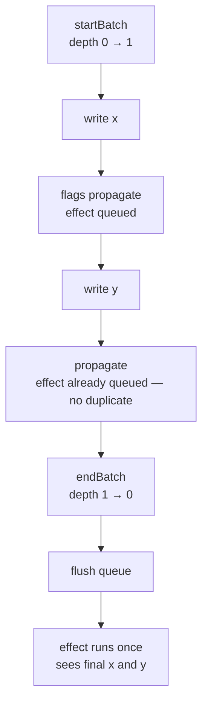

# Batching

```luau
startBatch() -> ()
endBatch() -> ()
getBatchDepth() -> number
```

Three functions around a module-level depth counter. Writes between `startBatch` and the matching outermost `endBatch` propagate their marks immediately but defer the effect flush — effects restart **once**, with all batched writes applied.

```luau
startBatch()
x(10)
y(20)
endBatch() -- every effect observing x and/or y ran once here
```

## startBatch

Increments the counter. Takes no arguments, returns nothing. Safe to nest — each `startBatch` needs exactly one matching `endBatch`.

## endBatch

Decrements the counter. When it reaches **zero** (the outermost batch ends), the effect queue flushes: queued effects run in order, once each. If the counter is still above zero, nothing happens yet.

Calling `endBatch` at depth zero decrements the counter to `-1` — unbalanced calls poison the counter, and flushes will then happen one level late (when the counter crosses back through zero). Pair your calls.

::: danger
`batchDepth` is caller-owned: unlike the library's internal state, an `endBatch` skipped due to a thrown error is *not* restored by the library. Guard batches that can throw:

```luau
startBatch()
local ok, err = pcall(function()
    -- writes that may throw
end)
endBatch() -- runs even on error
if not ok then
    error(err, 0)
end
```
:::

## getBatchDepth

Returns the current nesting level. Zero means "not batching" — the next top-level write or `endBatch` flushes immediately. Mainly useful for tests and debugging (the library's own test suite uses it to detect leaked batches).

```luau
getBatchDepth() -- 0
startBatch()    -- 1
startBatch()    -- 2
endBatch()      -- 1
endBatch()      -- 0 → flush
```

## Mechanics



- **Marks are immediate, flushes are deferred.** A write inside a batch sets `Dirty`/`Pending` flags right away; only the flush of the queue waits. Reads inside the batch still see fresh values (reads commit pending signal values lazily, on read).
- **The queue deduplicates.** An effect queued while already queued appears once.
- **Nesting is transparent.** Inner `startBatch`/`endBatch` pairs (from different functions, effects, or libraries) simply raise and lower the counter; only the outermost `endBatch` flushes.
- **Writes inside running effects are implicitly batched.** While an effect callback runs (`runDepth > 0`), its own writes defer their flush to the queue — this is what keeps self-restarting effects stable.

## Interaction with `trigger` and `effectScope`

- [`trigger`](./trigger) runs its reads and propagation inside an implicit batch, and flushes at its end — it composes with an enclosing batch like a nested pair.
- [`effectScope`](./effect-scope)'s function runs with batch-like deferral, so a component tree built inside a scope does not restart effects mid-build.

## Semantics recap

| Situation | Effect restarts |
|---|---|
| One write outside any batch | Once, immediately (at the write site) |
| N writes inside a batch | Once, at the outermost `endBatch` |
| Writes inside a running effect callback | Deferred to the queue — once per flush |
| All writes produce no value change (cutoff) | Zero |

## Upstream

Ported from `startBatch`/`endBatch` in [alien-signals `src/index.ts`](https://github.com/stackblitz/alien-signals/blob/master/src/index.ts). The `++`/`--` operators became `+=`/`-=` (Luau has no increment operators), preserving pre-decrement semantics.
