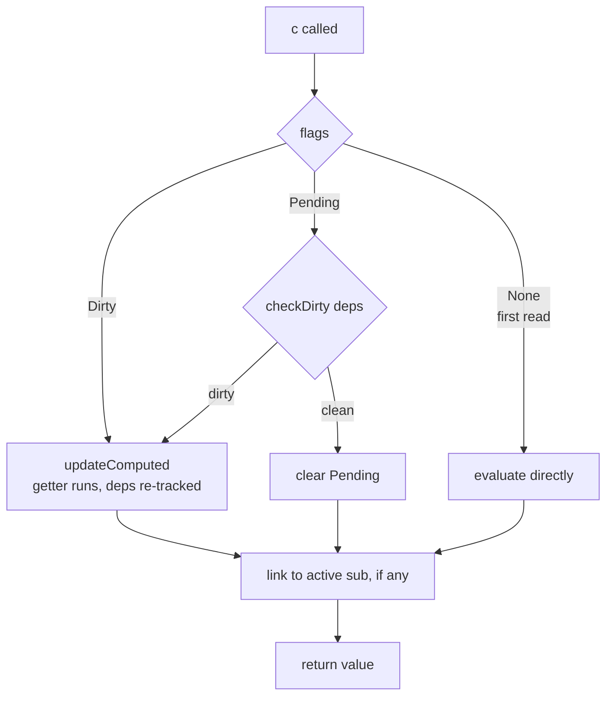

# computed

```luau
computed(getter: (previousValue: any) -> any) -> Computed
```

Creates a lazily-derived value. The getter runs only when a subscriber reads the computed, and re-runs only when the dirty-check concludes that its dependencies actually changed.

```luau
local a = signal(2)
local doubled = computed(function(prev: any)
    return a() * 2
end)

print(doubled()) -- getter runs → 4
print(doubled()) -- cache hit → 4
a(5)
print(doubled()) -- getter re-runs → 10
```

## Signature

| Call | Meaning |
|---|---|
| `computed(getter)` | Create a computed node with the given getter. |
| `c()` | Read: dirty-check, maybe re-run the getter, subscribe the active reader, return `c.value`. |

The getter receives one argument — the **previous value** of the computed (`nil` on the first run) — and must return the new value.

## Semantics

### Creation

The node starts with `ReactiveFlags.None` — no flags at all means "never evaluated yet". No flags, no deps, no value: nothing runs until the first read.

### The read path



- **First read** (flags `None`): the getter is evaluated directly with no previous value.
- **`Dirty`** (a write reached it): the getter re-runs.
- **`Pending`** (sources maybe changed): `checkDirty` walks the dependency chain; only if something genuinely changed does the getter re-run. Otherwise the pending flag is cleared and the cached value returns — the getter does **not** run.

Reading inside a running effect/getter links the computed to the reader. The reader subscribes to the *computed*, never to the computed's sources directly.

### The getter environment

While the getter runs:

- the computed itself is the active subscriber, so its reads become its dependencies,
- `cycle` is bumped so link versions stay distinct,
- the previous value is passed as the argument,
- on return, the new value is compared to the old one: **if equal, propagation stops** (cutoff).

If the getter throws, the computed's subscriber state and flags are restored first, then the error is re-thrown unchanged — the value is not updated.

### Dynamic dependencies

A conditional read makes the dep set exactly the branches actually taken that run, re-evaluated every run:

```luau
local mode = signal("a")
local a, b = signal(1), signal(1)

local val = computed(function()
    return if mode() == "a" then a() else b()
end)
-- run 1 deps: {mode, a} — writing b does nothing
-- after mode("b") and a read: deps {mode, b} — writing a does nothing
```

### Cutoff

When a re-run returns a value `==` the previous one, `shallowPropagate` does not mark the computed's subscribers — dependent effects do not restart. Note the getter *did* run; only the propagation beyond is cut. See [Computed Values: cutoff](../tutorials/computed#cutoff-when-the-value-does-not-change).

::: warning
Getters that construct fresh tables never compare equal — cutoff will never trigger for them. Use the `prev` argument to reuse the old table when nothing changed.
:::

### Nested computeds

Chains of any depth are supported; the dirty-check descends iteratively (array-as-stack, no recursion), so deep chains cannot overflow the call stack. Each level caches independently.

## Not writable

Calling a computed with an argument is not part of its calling convention — a computed is a read-only node. To change its outcome, write one of its sources.

## Trackability

Reads inside effects subscribe via the computed; the computed reconciles with its own sources. Untracked reads (plain value, no subscription) work the same way as for signals — read outside any effect, or use [setActiveSub](./advanced#setactivesub).

## Type guard

```luau
isComputed(value: any) -> boolean
```

Metatable-identity check; `false` for any non-computed. See [Type Guards](./type-guards).

## Examples

### Derived state

```luau
local hp, maxHp = signal(100), signal(100)

local fraction = computed(function()
    return hp() / math.max(1, maxHp())
end)

local color = computed(function()
    return if fraction() < 0.25
        then Color3.fromRGB(220, 50, 50)
        else Color3.fromRGB(80, 200, 80)
end)

effect(function()
    bar.FillColor = color()
end)
```

### Incremental computation with `prev`

```luau
local events = signal(nil :: { string }?)

local history = computed(function(prev: any)
    local result = table.clone((prev :: { string }?) or {})
    for _, e in events() or {} do
        table.insert(result, e)
    end
    return result
end)
```

### Keeping a computed hot

Computeds with no subscribers never recompute. To keep one evaluated:

```luau
local keepAlive = effect(function()
    expensiveComputed()
end)
-- disposing `keepAlive` (call it) lets the computed go cold again
```

## Errors

- A throwing getter restores the library state, then re-throws to the reader that triggered the evaluation.
- Reads of a computed whose getter throws therefore propagate the getter's error at the read site.

## Upstream

Ported from `computed` in [alien-signals `src/index.ts`](https://github.com/stackblitz/alien-signals/blob/master/src/index.ts). The `ComputedNode<T>` generic became a plain node with `any`-typed value/getter (Luau cannot type callable tables); the `'getter' in node` kind check became metatable identity.
