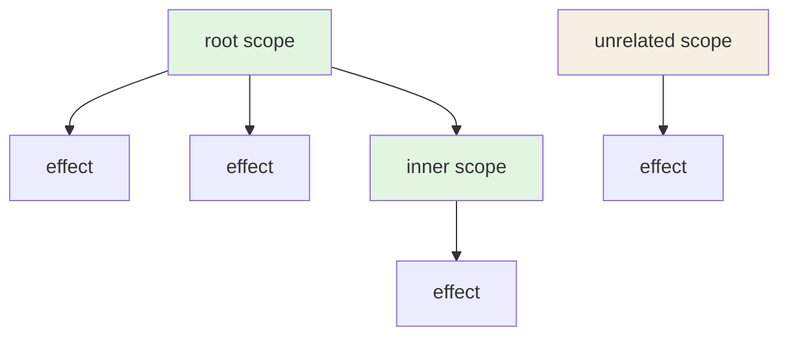

# effectScope

```luau
effectScope(fn: () -> ()) -> EffectScope
```

Runs `fn` with a fresh scope node as the active subscriber. Every effect (and nested scope) created while `fn` runs attaches to the scope. Calling the scope node disposes that whole subtree in one call.

```luau
local dispose = effectScope(function()
    effect(function() ... end)
    effect(function() ... end)
    effectScope(function()
        effect(function() ... end)
    end)
end)

dispose() -- all three effects (and the inner scope) are gone
```

## Signature

| Call | Meaning |
|---|---|
| `effectScope(fn)` | Create a scope node, run `fn` with it as the active subscriber, return the node. |
| `scope()` | Dispose the scope and everything attached beneath it. |

The function takes no arguments and returns nothing. Effects created *during* `fn`'s run become children of the scope; effects created **after** `fn` returned do not — the scope only groups what was built inside its function.

## Disposal

Calling the scope:

1. resets its flags and unlinks its dependencies,
2. detaches the link to its own parent (if the scope itself was nested),
3. recursively disposes everything attached to it.



`ROOT()` disposes `A`, `B`, `INNER`, and `C` — `OTHER`'s subtree survives. `INNER()` (if called directly) disposes only `C` and leaves the rest of the tree intact; the root's later disposal still finishes the job.

Second and later calls on the same scope are no-ops.

### Effects' cleanups run during scope disposal

Effects created inside the scope that returned cleanup functions get those cleanups executed when the scope is disposed — the scope is the "off switch" for everything, including per-run teardown:

```luau
local function healthbar(player: Player)
    local hp = signal(100)

    local dispose = effectScope(function()
        effect(function()
            local conn = player.CharacterAdded:Connect(function()
                hp(100)
            end)
            return function()
                conn:Disconnect() -- runs when the scope is disposed
            end
        end)
    end)

    return dispose
end

-- player leaves:
healthbarDisposer() -- connection disconnected, effect unlinked
```

## Semantics of the function run

- The scope node is the **active subscriber** while `fn` runs: any `effect`/`effectScope` call inside links to it (and marks it with a has-child flag so its dirty-check path knows to walk children).
- Reads of signals *directly inside `fn`* also link the scope to those signals — the scope behaves like an effect with no callback: it can be marked, queued, and "run" (its run is a no-op reset) by the system. In practice you only notice this if you read signals inside the scope function.
- The run is **batched**: the scope machinery wraps `fn` so the flush of effects created inside is deferred until the scope function completes — effects do not restart mid-build.
- If `fn` throws, the active subscriber is restored first, then the error is re-thrown. Anything already created inside remains created (and attached) — clean up via the scope's disposer, which is still returned if you catch the error at the call site.

## Typical pattern

```luau
--!strict
local signals = require(ReplicatedStorage["luau-signals"])
local signal, effect, effectScope = signals.signal, signals.effect, signals.effectScope

local Players = game:GetService("Players")

local controllers: { [Player]: () -> () } = {}

local function buildController(player: Player)
    local cash = signal(0)

    local dispose = effectScope(function()
        effect(function()
            leaderboard:Set(player, cash())
        end)

        effect(function()
            local conn = ReplicatedStorage.GrantCash
                .OnServerEvent:Connect(function(p, amount)
                    if p ~= player then return end
                    cash(cash() + amount)
                end)
            return function()
                conn:Disconnect()
            end
        end)
    end)

    return dispose
end

Players.PlayerAdded:Connect(buildController)
Players.PlayerRemoving:Connect(function(player)
    controllers[player] = nil
    -- call the stored disposer here for full teardown
end)
```

## Interaction with batches and the queue

- Effects created inside a scope are queued through the scope when writes arrive — the scope passes propagation down, and `notify`'s ordering still runs parents (the scope) before children (the effects).
- A scope disposed while effects are queued: those effects stop being reachable; the queue drains safely and the next write re-notifies whatever remains. No zombie restarts.
- Calling the scope's disposer **inside** `fn` (or from a nested effect) is legal: the disposal happens and the rest of the build continues attaching to a disposed scope — those nodes will not restart. Avoid it unless you really mean it.

## Type guard

```luau
isEffectScope(value: any) -> boolean
```

See [Type Guards](./type-guards).

## Errors

If `fn` throws, the subscriber state is restored and the error propagates from `effectScope(...)` — the scope node is still created and attached to whatever was built before the throw, so the disposer works for cleanup.

## Upstream

Ported from `effectScope` in [alien-signals `src/index.ts`](https://github.com/stackblitz/alien-signals/blob/master/src/index.ts). In the TypeScript original `EffectScopeNode` is an empty `interface` extension of `ReactiveNode`; in Luau it is a type alias — the node carries no extra fields, the metatable alone distinguishes it.
