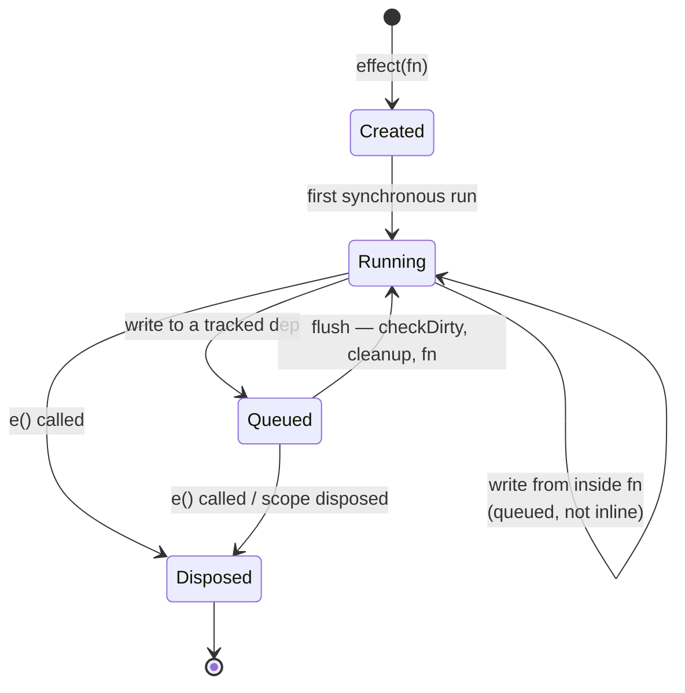

# effect

```luau
effect(fn: EffectFn) -> Effect
```

Runs `fn` immediately, tracks every signal/computed it reads, and re-runs `fn` whenever the dependency chain changes. The returned node **is** the disposer — call it to stop the effect permanently.

```luau
local count = signal(0)

local stop = effect(function()
    print(`count: {count()}`)
end) -- Output: count: 0

count(1) -- Output: count: 1

stop()   -- dispose
count(2) -- nothing
```

## Signature

| Call | Meaning |
|---|---|
| `effect(fn)` | Create an effect, run `fn` once immediately, return the effect node. |
| `e()` | Dispose: unlink all dependencies, run the cleanup (if any), detach children. |

`fn` may optionally return a **cleanup function**. Anything else returned (including `nil`) is treated as "no cleanup".

## The callback contract

- The **first run** happens synchronously inside `effect(...)` — it establishes what the effect tracks.
- Every signal/computed read *while the callback is running* is linked to the effect; reads in previous runs that did not happen this run are unlinked (dynamic dependencies).
- The callback may return a cleanup function, which runs before each re-run and on disposal.
- Re-runs happen from the flush queue — never inline at a write site, and never nested inside another effect's run: each queued effect runs once per flush in parent-before-child order.

## Lifecycle



### Disposal

Calling the effect node:

1. resets its flags and unlinks every dependency (the effect stops being a subscriber),
2. detaches its child-subscriber link if any (nested effects/scopes created inside it),
3. runs the cleanup function returned by the last run, if there is one.

After disposal the effect never runs again — even if its old dependencies change. A second dispose call is a no-op.

::: tip
The effect node doubles as its own disposer. If you need "run and never dispose", just discard the return value — the effect keeps running until its scope (or nothing) disposes it.
:::

### Cleanup

```luau
local target = signal(nil :: BasePart?)

effect(function()
    const part = target()
    if part == nil then return end

    local conn = part.Touched:Connect(function()
        -- ...
    end)

    return function()
        conn:Disconnect() -- runs before every re-run and on dispose
    end
end)
```

Cleanup runs with the active subscriber **cleared**: reads inside a cleanup function subscribe nothing.

If a cleanup function throws, the library restores the subscriber state first, then the error propagates to the caller that triggered the run (the flush at a write site, or the dispose call).

## Tracking details

### Dynamic dependencies

Dependencies are re-established on every run — a branch switch re-links to the taken branch and unlinks the old one:

```luau
local useA = signal(true)
local a, b = signal("A"), signal("B")

effect(function()
    print(if useA() then a() else b())
end)

b("B2")       -- no restart — b is not tracked this run
useA(false)   -- restart, prints B2; now b is tracked, a is not
a("A2")       -- no restart
```

### Writes inside the callback

Writing a signal inside the callback is allowed. The write propagates immediately (flags are set, subscribers marked), but effect *runs* are deferred to the queue — a self-subscribing effect restarts once per flush cycle, deterministically:

```luau
local count = signal(0)
effect(function()
    const c = count()
    print(c)
    if c < 3 then
        count(c + 1)
    end
end)
-- prints 0, 1, 2, 3 — each restart once
```

Writes performed while an effect runs are marked `Recursed` internally so the next flush distinguishes them from fresh outer writes.

::: warning
Two effects that write to each other's dependencies on every run can loop forever — the queue runs each restart once per value change but cannot detect a non-converging cycle. Make cycles converge or guard them.
:::

### Nesting

An `effect` (or `effectScope`) created inside a running effect callback is a **child**: the parent links it, and the parent's disposal disposes the child. The parent is also queued *before* its children by `notify`'s ordering — a parent's re-run settles the values children then observe.

## When the callback runs

| Trigger | Runs? |
|---|---|
| `effect(fn)` | Immediately, synchronously, once |
| Write to a tracked signal/computed (outside batch) | Once per flush, after `checkDirty` |
| Write to a tracked dep inside a batch | Once, at the outermost `endBatch` |
| Computed re-run returns same value (cutoff) | No |
| Write of an identical value (`==`) | No |
| `trigger` reading a tracked signal | Yes (once per flush) |
| Another effect's write to an untracked signal | No |

## Type guard

```luau
isEffect(value: any) -> boolean
```

See [Type Guards](./type-guards).

## Errors

- If `fn` throws on the **first** run, `effect` re-throws it after restoring state; the effect exists but has no dependencies.
- If `fn` throws on a **re-run**, the flush drains the rest of the queue first, then the error propagates from the write/flush site.
- If a cleanup throws, the state is restored and the error propagates from wherever triggered the run.

The library guarantees `activeSub` is `nil` and `runDepth` is `0` after any of these — no leaked subscriber state.

## Upstream

Ported from `effect` in [alien-signals `src/index.ts`](https://github.com/stackblitz/alien-signals/blob/master/src/index.ts). The disposer (`effectOper.bind(e)`) became the node's `__call` metatable; the `'fn' in node` kind check became metatable identity.
