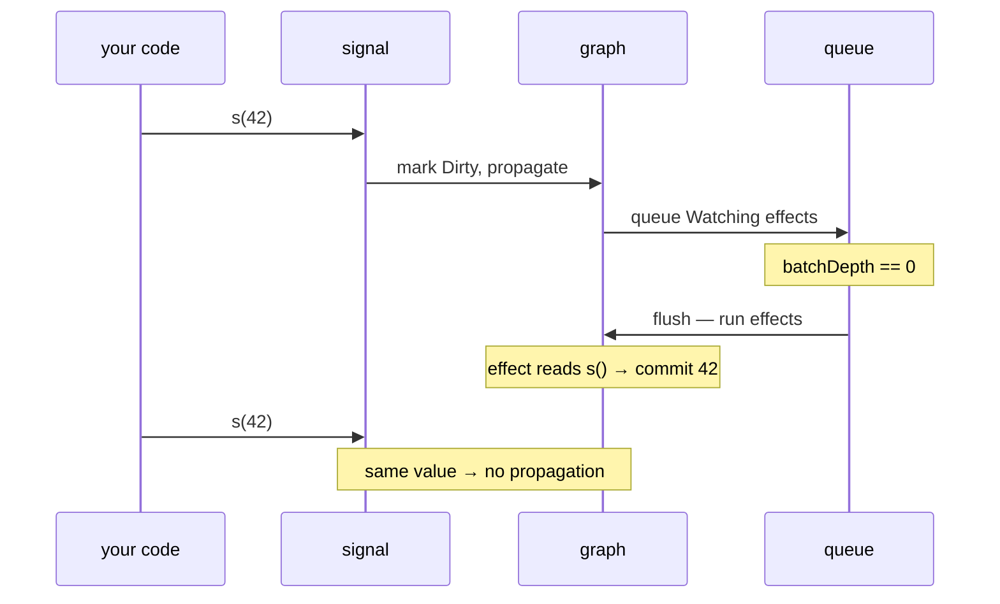

# signal

```luau
signal(initialValue: any?) -> Signal
```

Creates a reactive value. The returned node **is** the API — a callable table:

```luau
local count = signal(0)

count()    -- read  → the current value
count(5)   -- write → set the value, propagate to subscribers
count(nil) -- write → set the value to nil (still a write!)
```

Reads and writes are distinguished by argument count. `select('#', ...)` is used internally, so an explicit `nil` argument is a **write of `nil`**, not a read.

## Signature

| Call | Meaning |
|---|---|
| `signal(initialValue)` | Create a node with the initial value. The argument is optional — `signal()` creates a signal whose value is `nil`. |
| `s()` | Read the current value. Subscribes the active effect/getter, if one is running. |
| `s(value)` | Write. If the new value `~=` the pending one, marks the node dirty and propagates. |

## Semantics

### Creation

The node is allocated with all fields written up front (`currentValue`, `pendingValue`, and the five graph fields), the frozen `SIGNAL_META` metatable is attached, and the node is returned. Nothing else runs — no effects, no propagation.

### Reading

- If the signal is **dirty** (a write happened since the last read), the pending value is committed first, and subscribers are shallow-propagated so dependents settle.
- If a subscriber is active (an effect callback or a getter is running), the read links the signal to it — this is how tracking happens.
- Returns the committed `currentValue`.

A read **outside** any effect/getter is a plain value read with no side effects beyond a possible lazy commit.

### Writing

- The value is stored into `pendingValue`; `currentValue` is committed on the next read ([lazy commits](../tutorials/how-it-works#lazy-signal-commits)).
- If the new value is `==` to the old pending value, **nothing propagates** — same-value writes are no-ops for the graph.
- Otherwise the node is marked `Mutable|Dirty`, `propagate` walks its subscriber list, and — if `batchDepth == 0` — the flush runs the queued effects immediately. Inside a batch, the flush is deferred to `endBatch`.
- A write returns nothing (`nil`).

### Comparison

Equality is Luau `==` (which is strict, like `===` in JS): numbers, strings, booleans, `nil` compare by value; tables, functions, and instances compare by identity.

::: warning
Writing a freshly-built table each time (`s({pos = x})`) is a *new value* on every write even when contents match — every write will propagate. Store scalars, or reuse the same table when the content has not changed.
:::

## Trackability

A signal read inside a running effect, computed getter, or scope function links the signal to the reader. See [Signals & Effects](../tutorials/signals-and-effects#how-tracking-works) for the tracking model, and [Advanced: setActiveSub](./advanced#setactivesub) for untracked reads.

## Interaction with effects — the flow



## Type guard

```luau
isSignal(value: any) -> boolean
```

True exactly when `value` is a table whose metatable is the signal metatable. Non-tables (including strings, which share a metatable in Luau) return `false` rather than erroring. See [Type Guards](./type-guards).

## Examples

### A store

```luau
local coins = signal(0)

local function grant(amount: number)
    coins(coins() + amount)
end

effect(function()
    print(`coins: {coins()}`)
end)
```

### Signals holding nil

```luau
local selected = signal(nil :: Instance?)

effect(function()
    const target = selected()
    if target == nil then
        print("nothing selected")
    else
        print(`selected {target.Name}`)
    end
end)

selected(workspace.Baseplate) -- "selected Baseplate"
```

::: tip
`nil`-holding signals are fully supported: the node kind is determined by metatable identity, not by which fields happen to be non-nil.
:::

## Errors

The signal itself does not throw in normal use. If an effect reached by the write throws during the flush, the error propagates from the write site **after** the queue is drained and reset — the library never leaves the queue half-consumed.

## Upstream

Ported from `signal` in [alien-signals `src/index.ts`](https://github.com/stackblitz/alien-signals/blob/master/src/index.ts). The bound `signalOper` function became a callable table; the `'currentValue' in node` kind check became metatable identity.
