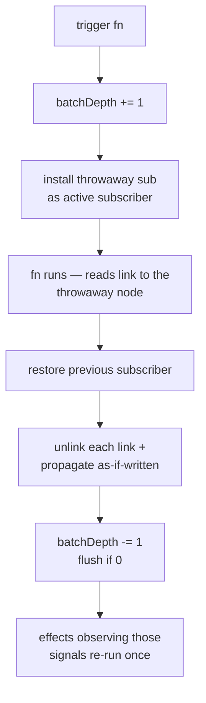

# trigger

```luau
trigger(fn: () -> ()) -> ()
```

Re-runs the effects that depend on the signals read inside `fn` — without changing any value. The "force a refresh" primitive.

```luau
local count = signal(1)
local runs = 0

effect(function()
    count()
    runs += 1
end) -- runs == 1

trigger(function()
    count()
end) -- runs == 2 — re-ran; the value is still 1
```

## How it works



1. A minimal `ReactiveNode` (no metatable, no callback — never notified or updated, it only collects deps) is installed as the active subscriber.
2. `fn` runs. Every signal/computed read inside links to that node.
3. Each link is unlinked and the dep is propagated manually — subscribers are marked and effects queued, exactly as if the dep had been written.
4. The implicit batch ends; the flush runs the queued effects.

The throwaway subscriber means reads inside `fn` subscribe **nothing permanently** — calling `trigger` from inside a running effect does not pollute that effect's dependency set.

## Signature

| Call | Meaning |
|---|---|
| `trigger(fn)` | Read-and-propagate as described above. |

`fn` takes no arguments. Its return value is ignored.

## Semantics

### Only what was read

Exactly the signals read during `fn` are propagated — the same dynamic-tracking rules as an effect run. A signal not read has no effect restarted:

```luau
local a, b = signal(1), signal(1)
local runsA, runsB = 0, 0

effect(function() a(); runsA += 1 end)
effect(function() b(); runsB += 1 end)

trigger(function() a() end)
-- runsA == 2, runsB == 1
```

### Batched: one restart per effect

The whole operation runs inside an implicit batch (`batchDepth` is incremented around `fn`), so an effect observing multiple read signals restarts **once**:

```luau
local a, b = signal(1), signal(1)
local runs = 0

effect(function() a(); b(); runs += 1 end)

trigger(function()
    a()
    b()
end) -- runs == 2 — one extra run, not two
```

### Cutoff still applies downstream

A computed whose getter re-runs (trigger propagation marks it dirty) and returns the same value cuts propagation — the computed's own effects do not restart. But note the getter **did** run: `trigger` forces evaluation, not free refreshes.

```luau
local raw = signal(1)
local parity = computed(function() return raw() % 2 end)
local direct, viaComputed = 0, 0

effect(function() raw(); direct += 1 end)
effect(function() parity(); viaComputed += 1 end)

trigger(function() raw() end)
-- direct == 2     — the effect reading the signal re-ran
-- viaComputed == 2 — the computed's getter re-ran; value unchanged
--                    but the computed is *read* by its effect during the
--                    restart, and cutoff prevents... see below
```

::: warning
Subtle: for the computed-reading effect, `parity`'s getter re-runs during the dirty check and returns the same value — the *mark* on the effect was already set by the propagation, and the effect restarts because the dirty-check found the computed dirty at flush time. Do not rely on cutoff to suppress `trigger` restarts through computeds; rely on it for ordinary write-cutoffs.
:::

### Value never changes

`trigger` never writes. The signal's `pendingValue`/`currentValue` are untouched; effects simply re-run and re-read the same values. Reads inside the re-run see current state as usual.

### Nothing happens without reads

```luau
trigger(function()
    print("no signals here")
end) -- no propagation, no effect restarts
```

## Errors

If `fn` throws, the throwaway subscriber's links are still unlinked and propagated (that cleanup runs before the re-throw), and the batch/flush state is restored — then the error propagates from the `trigger` call site. Effects queued by the propagation before the throw still flush at the (restored) end of the implicit batch.

## When to reach for it

| Situation | Use |
|---|---|
| Non-reactive source changed (instance property, external cache) | `trigger` around a read of a "version" signal, or of the dependent signal |
| Force a UI re-render on a non-value event | `trigger` reading the signals the render effect uses |
| Same logical change, but no natural value to write | `trigger` — or a version-counter signal written normally |
| Coalescing multiple *writes* | [startBatch/endBatch](./batching) — `trigger` is for no-write refreshes |

See [Trigger tutorial](../tutorials/trigger) for worked examples.

## Upstream

Ported from `trigger` in [alien-signals `src/index.ts`](https://github.com/stackblitz/alien-signals/blob/master/src/index.ts). The temporary subscriber is a bare `ReactiveNode` in both; in Luau it carries no metatable, and `unwatched` would treat it as a scope if it were ever reported (it never is — it is unlinked before anything can report it).
