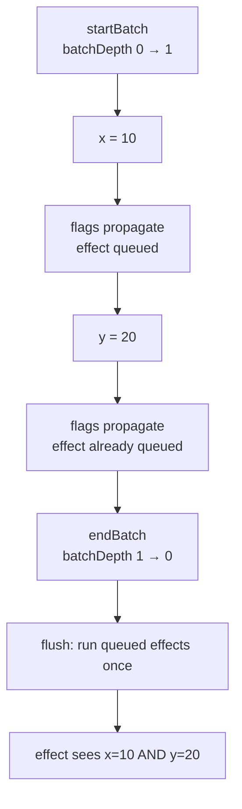

# Batches

A batch groups writes so that the effects they reach restart **once**, after all writes in the group are applied. It is the tool for "these changes belong together" — updating two coordinates, applying a config, resetting a set of related values.

```luau
local signals = require(ReplicatedStorage["luau-signals"])
local signal, computed, effect, startBatch, endBatch =
    signals.signal, signals.computed, signals.effect, signals.startBatch, signals.endBatch

local x, y = signal(1), signal(1)
local position = computed(function() return `{x()}, {y()}` end)

effect(function()
    print(`position: {position()}`)
end) -- Output: position: 1, 1

startBatch()
x(10)
y(20)
endBatch() -- Output (one line): position: 10, 20
```

Without the batch, the effect restarts twice — once after `x(10)` (printing `position: 10, 1`) and once after `y(20)`.

## How batching works

`startBatch`/`endBatch` maintain a depth counter. Writes inside a batch propagate dirty flags as usual, but the flush of the effect queue is deferred until the **outermost** `endBatch`:



Key properties:

- **Batches nest.** `startBatch`/`endBatch` pairs can be nested (including from different functions); only the outermost `endBatch` flushes. The depth counter makes inner pairs transparent.
- **Flags are not deferred** — only the flush. So a write inside a batch still marks a computed pending immediately; a read *inside* the batch (from plain code, or a computed read during the flush) sees correct fresh values because reads commit pending values lazily anyway.
- **The queue itself batches.** An effect queued while already queued is not duplicated — it appears once in the flush.

## When to batch

Batch whenever **multiple signals change as one logical change**:

```luau
-- moving a unit: position is one fact, spread over two signals
startBatch()
gridX(3)
gridY(7)
endBatch()

-- applying a preset: many settings at once
local function applyPreset(preset: { [string]: number })
    startBatch()
    for key, value in preset do
        settings[key](value)
    end
    endBatch()
end
```

You do **not** need a batch when:

- a single signal changed (one write = one flush anyway),
- nothing observes the values (no subscribers → nothing queued → nothing to batch),
- or the intermediate state is genuinely desired (a stepping animation, staged reveal).

## Batch writes inside effects

Writes performed inside a running effect are implicitly batched by the flush machinery — `runDepth` is nonzero while an effect callback runs, and inner writes defer their flush to the queue instead of running effects inline. This is what keeps self-observing effects (see [Signals & Effects](./signals-and-effects#writes-inside-effects)) stable.

An explicit `startBatch()` in one place and its `endBatch()` in another is legal but discouraged — the counter has to return to zero for the flush to happen. If an error is thrown between them, the counter stays elevated and subsequent writes stop flushing. Guard it:

```luau
local function guarded(body: () -> ())
    startBatch()
    local ok, err = pcall(body)
    endBatch() -- runs even on error; flush happens if depth hit 0
    if not ok then
        error(err, 0)
    end
end
```

::: tip
The library itself restores its own internal state (`activeSub`, `runDepth`) on thrown errors via `pcall`+re-`error` in every guarded section — but `batchDepth` is a caller-owned counter: it is your `endBatch` that restores it.
:::

## `getBatchDepth`

`getBatchDepth()` reports the current nesting level — `0` means the next `endBatch` (or a top-level write) triggers a flush. It is mainly a debugging/testing tool:

```luau
print(getBatchDepth()) -- 0
startBatch()
print(getBatchDepth()) -- 1
startBatch()
print(getBatchDepth()) -- 2
endBatch()
print(getBatchDepth()) -- 1
endBatch()             -- flush happens here
print(getBatchDepth()) -- 0
```

## Batches and computeds

A batch does not force computed evaluation — laziness survives batching. Sources are written, flags are pushed, effects are queued; the getters still run only when a queued effect reads the computed during its restart. Combine with cutoff (unchanged computed values stop propagation) and a batch can end with **zero** effect restarts:

```luau
local raw = signal(1)
local parity = computed(function() return raw() % 2 end)
local runs = 0

effect(function()
    parity()
    runs += 1
end) -- runs == 1

startBatch()
raw(3)  -- parity will be 1 (was 1) — cutoff candidate
raw(5)  -- parity will still be 1
endBatch() -- getter runs once during flush, value unchanged → runs stays 1
```

## Alternative: `trigger`

For "re-run observers **without** changing any value" — a forced refresh — see [Trigger](./trigger). It composes with batching too (its reads and propagation run inside an implicit batch).

## Next steps

- [Effect Scopes](./effect-scopes) — disposal semantics
- [API: Batching](/api/batching) — `startBatch` / `endBatch` / `getBatchDepth` reference
- [How It Works](./how-it-works) — the queue and flush algorithm
