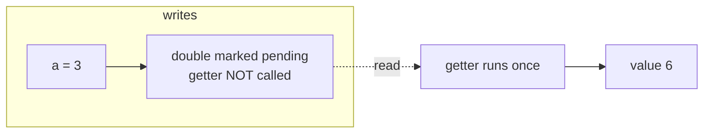
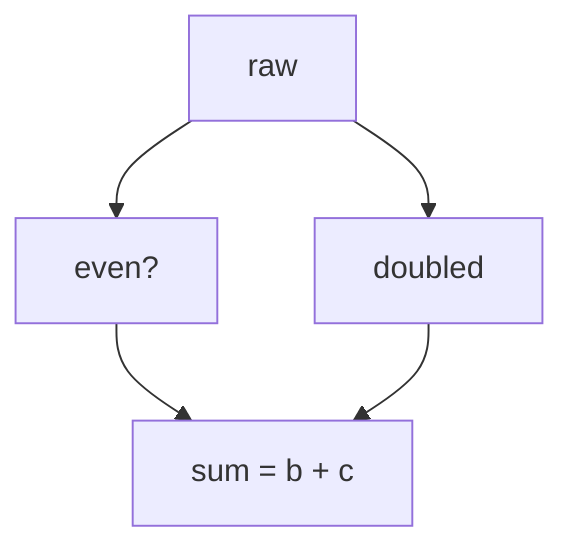

# Computed Values

`computed` derives a value from signals (or other computeds). It is lazy — the getter runs only when somebody reads it — and cached — repeated reads without changed inputs do not re-run the getter.

```luau
local signals = require(ReplicatedStorage["luau-signals"])
local signal, computed, effect = signals.signal, signals.computed, signals.effect

local price, qty = signal(100), signal(1)
local total = computed(function()
    return price() * qty()
end)

print(total()) -- getter runs, → 100
print(total()) -- cache hit, → 100 (getter does NOT run again)

price(250)
print(total()) -- getter runs once, → 250
```

## Lazy: unobserved computeds never recompute

The single most important property of `computed` in this library: writing to a source never evaluates the chain unless a subscriber reads it.

```luau
local a = signal(1)
local runs = 0

local double = computed(function()
    runs += 1
    return a() * 2
end)

a(2) -- runs == 0 — `double` is marked pending, nothing computes
a(3) -- runs == 0 — still nothing
print(double()) -- runs == 1, → 6
```

A computed whose only observer is an effect inherits this on the write side: the write marks things pending and queues the *effect*; the getter re-runs once, during the effect's restart, when the effect reads the computed.



This is the "pull" half of push–pull, and it is why deep unobserved chains cost nothing.

## Chained computeds

Computeds can read other computeds, forming chains of any depth. Each level stays independently cached and lazy:

```luau
local base = signal(10)
local doubled = computed(function() return base() * 2 end)
local quadrupled = computed(function() return doubled() * 2 end)
local label = computed(function() return `value: {quadrupled()}` end)

print(label()) -- one pass down the chain, → "value: 40"
```

During a restart, the dirty check walks the chain and recomputes only the links whose sources actually changed — a "recursed" chain with no changed sources settles without any getter call.

## The previous-value argument

The getter receives the computed's previous value as its argument. This is the hook for incremental computation — accumulating, diffing, or memoizing more than a scalar:

```luau
local commands = signal(nil :: { string }?)

local log = computed(function(prev: any)
    const newCommands = commands()
    -- prev is the previous result of this computed, nil on the first run
    local result = table.clone((prev :: { string }?) or {})
    for _, cmd in newCommands or {} do
        table.insert(result, cmd)
    end
    return result
end)
```

::: tip
The argument is `nil` on the very first run — always handle that case.
:::

## Cutoff: when the value does not change

If a re-run produces the *same* value as before, the computed's subscribers are **not** notified — the change is cut off at that node:

```luau
local raw = signal(10)
local parity = computed(function() return raw() % 2 end)

local runs = 0
effect(function()
    parity()
    runs += 1
end) -- runs == 1

raw(12) -- parity recomputes 12 % 2 == 0, same as before
        -- runs stays 1 — the effect does not restart
raw(13) -- parity recomputes to 1
        -- runs == 2
```

This is one place where the library's push–pull model shows up directly: the recompute happens (the getter runs), but the propagation beyond stops when the value is `==` to the old one.

::: warning
Comparison is by identity/`==` semantics. A getter that returns a **fresh table** every run will never cut off (the tables are never `==`), even when the contents are identical. If your computed builds containers, either reuse the old table when nothing changed (via `prev`) or make the cutoff irrelevant by keeping subscribers cheap.
:::

## Diamonds and freshness

The classic diamond — one source flowing through two computeds into a third — is safe:



```luau
local raw = signal(1)
local b = computed(function() return raw() % 2 end)
local c = computed(function() return raw() * 2 end)
local sum = computed(function() return b() + c() end)

effect(function()
    print(`sum = {sum()}`)
end) -- sum = 3

raw(3) -- prints "sum = 5", exactly once — never "sum = 4" then "sum = 5"
```

An effect (or computed) reading `sum` can never observe the intermediate state where `b` is fresh and `c` is stale: the dirty check walks *all* deps before concluding, and recompute happens inside that walk, bottom-up in dependency order.

## Computed nodes are callable, like signals

Read a computed by calling it — inside another getter or effect for tracking, outside for a plain value:

```luau
print(total()) -- plain read anywhere
```

A read inside a running effect/getter subscribes the reader to the computed, so later source changes reach it through the computed — the reader never links to the computed's *sources* directly. That means swapping the internals of a getter (adding a source, removing one) automatically rewires the graph on the next run, exactly like [dynamic dependencies in effects](./signals-and-effects#dynamic-dependencies).

## What computed is not

- **Not writable.** Calling a computed with an argument throws (`computed is read-only` in behavior: the metatable's `__call` only implements reads). To change the outcome, write a source.
- **Not eager.** There is no option to pre-compute. If you need a value kept hot, attach a no-op effect: `effect(function() c() end)`.
- **Not for side effects.** A getter that *does* things (touches instances, prints) will surprise you: it runs exactly when the dirty-check decides to, not on every source write. Effects are for side effects; computeds are for values.

## Inside a computed, reads track the computed

While a getter runs, the computed itself is the active subscriber. So a conditional read in a getter — `if flag() then return a() else return b() end` — makes the computed's dep set exactly `{flag, a}` or `{flag, b}` for that run, re-evaluated every run. Same dynamic-dependency story as effects, one level up.

## Performance notes

- Chained computeds reconcile with an iterative dirty-check that uses an explicit array-as-stack — no recursion, so arbitrarily deep chains cannot blow the call stack.
- Deep unobserved chains are free after the first read: nothing walks them until a subscriber appears.
- The benchmark table in the README measures this directly: "derive: unobserved (lazy vs eager)" is the case where eager libraries recompute and this library does nothing.

## Next steps

- [Batches](./batches) — coalescing the writes that feed a chain
- [How It Works](./how-it-works) — checkDirty, propagation and cutoff internals
- [API: computed](/api/computed)
