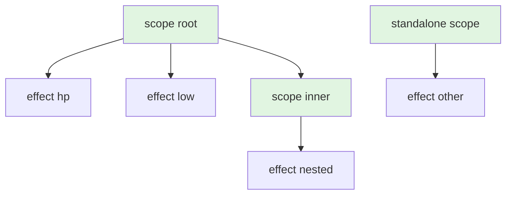

# Effect Scopes

`effectScope` runs a function with a fresh scope node as the active subscriber. Every effect created inside — directly or nested further — links to that scope. Calling the scope disposes everything beneath it in one call.

```luau
local signals = require(ReplicatedStorage["luau-signals"])
local signal, effect, effectScope = signals.signal, signals.effect, signals.effectScope

local hp = signal(100)

local dispose = effectScope(function()
    effect(function()
        print(`hp: {hp()}`)
    end)
    effect(function()
        print(`low: {hp() < 25}`)
    end)
end) -- Output: hp: 100, low: false

hp(10) -- Output: hp: 10, low: true

dispose()
hp(1)  -- nothing — both effects are gone
```

## The disposal tree

Scopes and effects form a tree through the same linked-list graph that signals use. A scope node has no callback of its own — it is a pure grouping node — but it participates in propagation exactly like an effect would, so writes still reach the nested effects while the scope is alive.



Disposing the root scope (`S1`) removes `E1`, `E2`, `S2` and `E3` — everything reachable downward. `S3`'s subtree is untouched.

Dispose by **calling the scope** (its metatable's `__call` is the disposer). The scope node itself is the return value of `effectScope`:

```luau
const dispose = effectScope(function() ... end)
dispose() -- collective disposal, once
dispose() -- second call is a no-op
```

## The component pattern

The flagship use for scopes is teardown-heavy code: a UI component, a per-player controller, a unit's logic bundle. Build everything inside one scope, keep the disposer, call it when the thing goes away:

```luau
--!strict
local signals = require(ReplicatedStorage["luau-signals"])
local signal, computed, effect, effectScope =
    signals.signal, signals.computed, signals.effect, signals.effectScope

local function buildHealthbar(player: Player, gui: Instance)
    local hp = signal(player.Character and 100 or 0)

    local bar = Instance.new("Frame")
    -- ... build the frame hierarchy under `gui` ...

    const dispose = effectScope(function()
        effect(function()
            local fraction = hp() / 100
            bar.Size = UDim2.fromScale(fraction, 1)
        end)

        effect(function()
            bar.BackgroundColor3 = if hp() < 25
                then Color3.fromRGB(220, 50, 50)
                else Color3.fromRGB(80, 200, 80)
        end)
    end)

    -- one handle tears down *all* reactive wiring
    return function()
        dispose()
        bar:Destroy()
    end
end
```

When the player leaves, call the returned function: every effect inside the scope is disposed (their cleanups run), and no further signal writes touch the destroyed UI.

::: tip
Effects with cleanup functions get their cleanup run during scope disposal — so connections made inside the effects are disconnected for you. Scopes compose with the cleanup pattern: cleanup handles per-run resources, the scope handles the whole lifetime.
:::

## Nested scopes and effects

Anything created while a scope's function runs — nested `effectScope`s, plain effects, even computeds read indirectly — attaches to the nearest enclosing subscriber. Nesting scopes gives you sub-components with their own disposer that the parent's disposer also removes:

```luau
local rootDispose = effectScope(function()
    local innerDispose = effectScope(function()
        effect(function() print("inner") end)
    end)
    effect(function() print("outer") end)
    -- innerDispose is a handle you *could* call early
    innerDispose() -- disposes just the inner effect
end)

-- rootDispose() would dispose everything remaining
```

An effect created inside another effect's callback is likewise a child of that effect — disposing the parent effect (calling it) disposes the child effects.

::: warning
A child effect whose parent is disposed stops re-running, but calling the parent's disposer **does not run** child effects' cleanups unless the child was reachable as a dependency link. Keep teardown for things you *created inside effects* in those effects' own cleanup returns — that is the reliable path.
:::

## Batch, then dispose

Disposal interacts safely with a pending flush: a scope disposed inside a batch (or during a flush) unlinks its effects from the graph, and queued-but-never-run effects are drained by the flush with a mark that makes the next write re-notify them — no zombie restarts.

A scope's function runs with batching semantics (the scope machinery defers its flush like a batch), so building a whole component tree inside `effectScope` does not restart effects mid-build — everything settles once, at the end of the scope function.

## Scopes and `getActiveSub`

A scope (like an effect) is a subscriber node. While its function runs, `getActiveSub()` returns the scope node. This is occasionally useful for advanced patterns — passing the current subscriber elsewhere, or installing your own node — but is not something most code needs. See [Advanced](/api/advanced).

## When *not* to use a scope

- A single effect with a good cleanup return needs no scope — call the effect (its disposer) directly.
- Computeds need no scopes: they have no side effects to tear down and their subscriptions die with their last reader.
- Instance lifetime alone (`Instance.Destroying`) does not remove reactive subscriptions — you still need the disposer call, as in the example above.

## Next steps

- [Trigger](./trigger) — forced re-runs
- [How It Works](./how-it-works) — what disposal actually unlinks
- [API: effectScope](/api/effect-scope)
