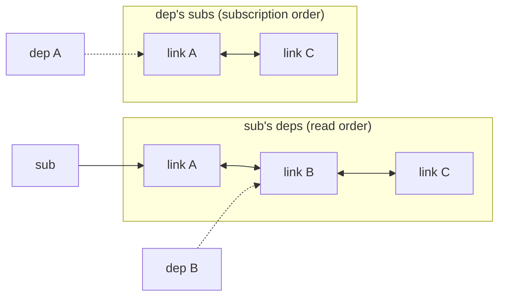
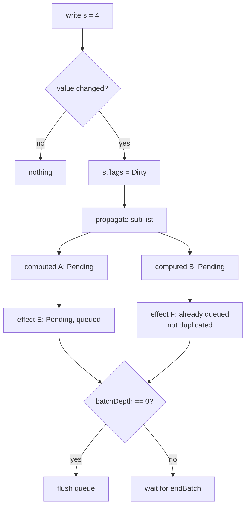
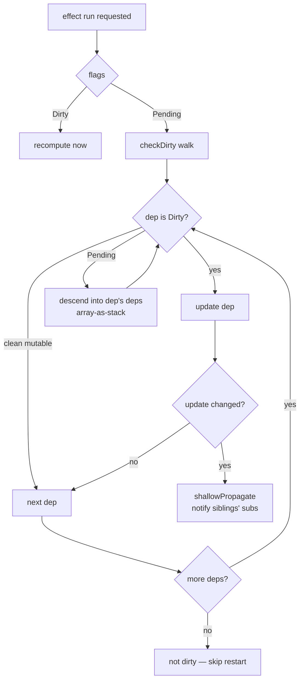

# How It Works

This page documents the machinery under the API: the graph representation, the flag system, and the push–pull algorithm. It mirrors the two source files — `src/system.luau` (the graph) and `src/init.luau` (the nodes) — so you can read this alongside the code.

## The graph

Every signal, computed, effect, and scope is a **node** with five bookkeeping fields:

```luau
type ReactiveNode = {
    deps: Link?,      -- head of "what I read" list
    depsTail: Link?,  -- tail of the same list
    subs: Link?,      -- head of "who reads me" list
    subsTail: Link?,  -- tail of the same list
    flags: number,    -- state bitset
}
```

Nodes are connected by `Link` objects — one link per (dependency, subscriber) pair:

```luau
type Link = {
    version: number,
    dep: ReactiveNode,  -- the node being read
    sub: ReactiveNode,  -- the node reading it
    prevSub/nextSub,    -- siblings in dep's subscriber list
    prevDep/nextDep,    -- siblings in sub's dependency list
}
```

Each link is threaded into **two** doubly-linked lists at once:



Why linked lists and not `Set`/`Map`? The port preserves the upstream constraint of **zero hashing on the hot path**: checking "is this dep already linked" is a pointer walk over freshly-used links (the tail is the most recently read), and re-running an effect reuses the same link objects when read order is stable. Every `Link` is a flat table with all seven fields written at creation — including the `nil`s — so the hash part is allocated once and no link ever rehashes mid-graph-update.

## The flag system

Each node's state lives in a bitset (`flags`), checked with `bit32.btest`:

| Flag | Value | Meaning |
|---|---|---|
| `Mutable` | 1 | A mutable source of truth (signal) or needs-refresh group (scope) |
| `Watching` | 2 | An effect/scope that is alive and subscribed |
| `RecursedCheck` | 4 | Depth-tracker for reentrancy bookkeeping |
| `Recursed` | 8 | The node was reached by a write during its own run |
| `Dirty` | 16 | Definitely needs recompute/restart |
| `Pending` | 32 | Maybe stale — sources changed, verify on read |

Combined masks (precomputed, compile-time-folded with `--!optimize 2`) drive the fast paths. `Dirty` short-circuits: no verification needed, recompute. `Pending` defers the work: the next read decides via a dirty-check walk whether any source *actually* changed.

## Push: `propagate`

A write (value changed) calls `propagate` from the signal's subscriber list. It walks *down* the graph — signal → computeds → effects — setting `Pending` (or `Pending|Recursed` for writes that happen while a subscriber is running), and **queues** any `Watching` node (effect) it reaches:



No values are computed during the push. Computeds reached are merely *marked*. This is what makes unobserved chains free: marks with no subscriber path go nowhere, and even observed chains do no getter work yet.

`propagate` is iterative, not recursive: a stack of branch-points is kept in a plain array with a depth counter (lazily created, `table.create(4)`), so arbitrarily wide graphs cannot overflow the call stack.

## The queue and `flush`

Queued effects live in a module-level array. `notify` appends an effect (clearing its `Watching` flag so it is not double-queued) and **walks upward**: if the effect's subscriber-link leads to a parent effect that is also `Watching`, the parent is queued too — before the child, because the inserted run is reversed in place. Parents run first, children after — the glitch-free ordering.

`flush` drains the queue in order, running each effect. If an effect throws, the remaining queued effects are drained with `Recursed` marks (so the next write re-notifies them), the cursors are reset, and the error re-throws — the queue is never left half-consumed.

## Pull: `checkDirty`

When a queued effect runs, it does not blindly recompute. `run` inspects its flags: if `Dirty`, recompute; if `Pending`, run `checkDirty` over the dependency list first:



The walk descends into pending computeds recursively (again with an array-as-stack, no call-stack growth), calling `update` on each: for a computed that means re-running the getter (`updateComputed`); for a signal, committing its pending value (`updateSignal`). If any dep genuinely changed, the effect is dirty and restarts; if everything settled to unchanged values, the restart is skipped entirely.

This is the "pull": work happens exactly at read time, in dependency order, only where the marks say something might have changed.

## `shallowPropagate` — settling siblings

When a computed recomputes during a dirty-check and its value *changed*, its sibling subscribers (other effects watching the same computed) must be woken too — but only one level: `shallowPropagate` walks the computed's subscriber list, upgrading `Pending` to `Dirty` where appropriate and queueing `Watching` effects. It does not descend further; deeper propagation happens when those subscribers run and dirty-check *their* deps.

## Lazy signal commits

A signal write stores into `pendingValue` and marks `Dirty`; the `currentValue` is committed **on the next read** (`updateSignal`). Reads outside effects get the fresh value because `signalOper`'s read path checks the `Dirty` flag and commits first. This keeps the write path minimal (store + mark + propagate) and defers the commit until someone actually cares.

## Node kinds and metatables

Each of the four kinds has a frozen metatable with a `__call` handler:

| Node | Metatable | `__call` does |
|---|---|---|
| signal | `SIGNAL_META` | read (0 args) / write (1 arg) |
| computed | `COMPUTED_META` | read with dirty-check |
| effect | `EFFECT_META` | dispose |
| scope | `EFFECT_SCOPE_META` | dispose |

The node **is** the API — the upstream's bound functions become callable tables, so no closure is allocated per node. The metatables double as kind tags: the internal dispatch (`update`, `unwatched`) discriminates by `getmetatable(node)` identity instead of the TS `'getter' in node` field checks, which cannot be ported to Luau (a `nil`-valued field does not exist there — `signal(nil)` would lose its kind marker). `isSignal`/`isComputed`/`isEffect`/`isEffectScope` are the public wrappers over the same identity checks.

## `pcall` in place of `try`/`finally`

Luau has no `finally`, so every upstream `finally` block is a `pcall` + state restoration + `error(err, 0)` re-throw: `runCleanup`, `updateComputed`, `run`, `flush`, `effect`, `effectScope`, and `trigger` all restore `activeSub`, `runDepth`, and the queue/batch state even when the user callback throws. The error object itself propagates unchanged (level `0` attaches no position info).

The one caller-owned piece is `batchDepth`: your `startBatch` needs its `endBatch` even on an error path (see [Batches](./batches)).

## Complexity and performance notes

- **Write cost** is proportional to the subscriber path length actually marked — unobserved branches cost nothing.
- **Read cost** on a settled graph is a flag test; on a pending graph it is the dirty-check walk, which short-circuits at the first genuinely-changed dep.
- **Effect re-run** reuses dependency links in read order — stable read order means zero link allocation.
- The hot-path flag operations use standalone `FLAG_*` constants (upvalue reads are cheaper than table field reads), combined masks are precomputed, and with `--!optimize 2` the constant `bit32` calls fold at compile time.
- The whole graph uses no `Set`, no `Map`, no `ipairs`, no string keys on the hot path, no closures per node, and recursion only in the user callback — the library's own walks are all iterative.

## Reading the source

The two files are heavily annotated with the reasoning behind every port decision:

- `src/system.luau` — the graph primitives: `link`/`unlink`, `propagate`, `checkDirty`, `shallowPropagate`, `isValidLink`, and `createReactiveSystem` (the factory that ties them to the callbacks the node layer provides).
- `src/init.luau` — the nodes: `signal`/`computed`/`effect`/`effectScope`/`trigger`, the `__call` metatables, the flush queue, and the batching entry points.

Each `--NOTE:` comment explains what the corresponding TypeScript construct became in Luau and why — the files double as a Rosetta stone for anyone porting other TS reactive systems.
