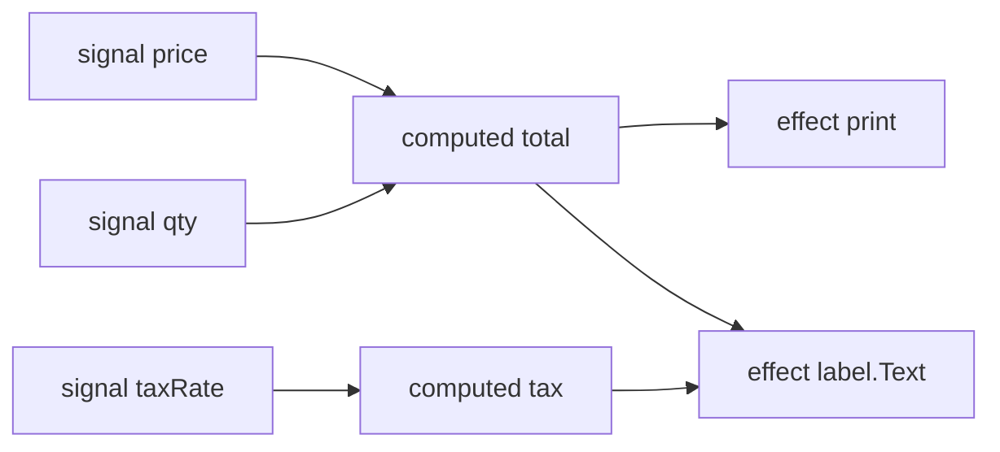
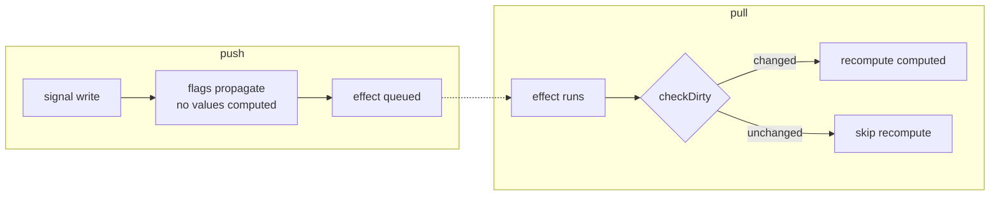
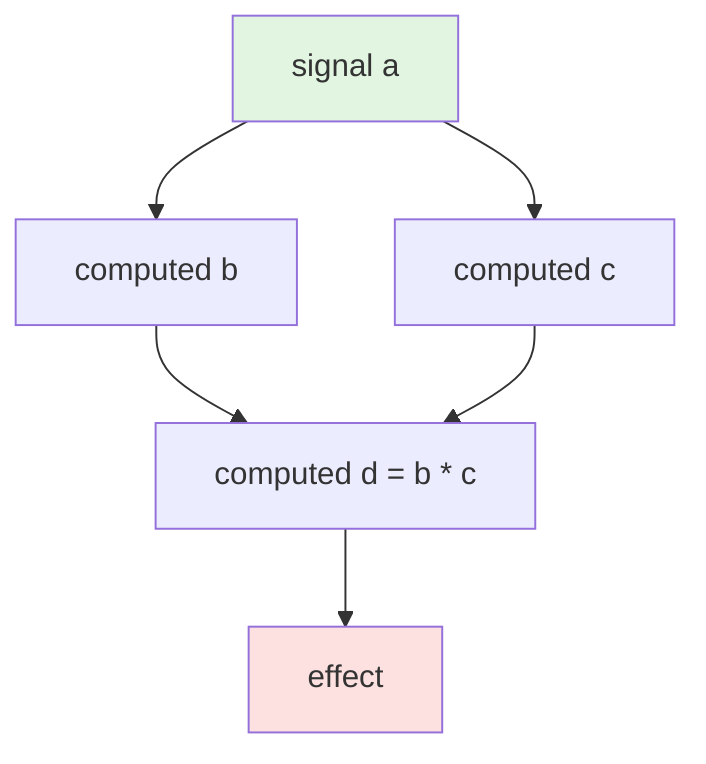

# Introduction

`luau-signals` is a Luau port of [alien-signals](https://github.com/stackblitz/alien-signals), a push–pull reactive signal library whose core algorithm has been adopted by [Vue 3.6](https://github.com/vuejs/core/tree/minor). It brings the same four primitives to Luau and Roblox:

| Primitive | Role |
|---|---|
| `signal` | Holds a piece of state |
| `computed` | Derives a value from other signals, lazily |
| `effect` | Runs a callback when the values it reads change |
| `effectScope` | Groups effects so a whole tree can be disposed at once |

```luau
const signals = require(ReplicatedStorage["luau-signals"])
local signal, computed, effect, effectScope, startBatch, endBatch =
    signals.signal, signals.computed, signals.effect, signals.effectScope,
    signals.startBatch, signals.endBatch

local price, qty = signal(100), signal(2)
local total = computed(function()
    return price() * qty()
end)

local dispose = effectScope(function()
    effect(function()
        print(`Total: {total()}`)
    end)
end) -- Output: Total: 200

price(150) -- Output: Total: 300

startBatch()
price(200)
qty(5)
endBatch() -- Output: Total: 1000

dispose() -- Unsubscribes the whole scope
price(999) -- Nothing is printed
```

## Why signals?

Roblox UI and gameplay code tends to be built out of two patterns that both scale poorly:

- **Polling** — a loop or `RunService.RenderStepped` handler that re-reads state every frame and diffs it by hand. Most frames, nothing changed.
- **Event soup** — one `RBXScriptConnection` per fact, with every consumer manually wiring and remembering to disconnect. Miss one, and a destroyed UI keeps receiving updates.

Signals invert the control. State declares itself once; consumers declare what they read once; the library keeps the wiring between them alive and cuts it when either side goes away:



One write to `price` propagates through `total` to every effect that (transitively) depends on it — exactly once, with the settled value, and only after every intermediate value is up to date.

## Push–pull in one paragraph

The library's core idea is that a change is two phases, not one:

- **Push (write):** when a signal's value changes, dirty flags are pushed through the graph *downward* — subscribers are marked "maybe stale" and effects are queued. No values are computed during the push.
- **Pull (read):** when a subscriber runs, it checks the dirty chain and recomputes only the parts of the chain that actually changed.



The consequence is that a computed with **no subscribers is never recomputed**, no matter how many times its sources are written:

```luau
local a = signal(1)
local expensive = computed(function()
    -- never runs unless somebody reads it
    return a() * 2
end)

a(2) -- nothing happens; `expensive` is lazily pending, that's all
a(3) -- still nothing
print(expensive()) -- the getter runs once, now: 6
```

This is the difference between alien-signals' 17× win on unobserved workloads and an eager-update library that recomputes on every write.

## Glitch-free updates

A **glitch** is a transient inconsistent state an observer can see: in a diamond `a → (b, c) → d`, a naive implementation might run the `d` effect after `b` updated but before `c` did, so `d` briefly sees `b_new * c_old`.

`luau-signals` cannot glitch, because effects run only from the flush queue, and the queue is ordered so that an effect runs *after* all of its dependencies' subscribers have been processed:



Writing `a` marks `b` and `c` pending, but `d`'s effect does not run until `b` and `c` have settled, so the effect's callback always sees a consistent `d`. The same guarantee holds inside a batch: any number of writes, one coherent restart.

## What is a signal, concretely?

A signal in this library is a **callable table** — the node *is* the API:

```luau
local count = signal(0)
count()    -- read → 0
count(5)   -- write
count()    -- read → 5
```

There is no `.get()`/`.set()` and no separate watcher object. Under the hood each node is a small flat table with five bookkeeping fields (dependency/subscriber linked-list heads and tails, plus a flag bitset), and a frozen metatable whose `__call` dispatches reads and writes. Because the node carries its own metatable, no closure is allocated per signal — one table, one metatable set at creation, that is the whole cost.

## Where to go next

- [Getting Started](./getting-started) — install the package and run your first effect
- [Signals & Effects](./signals-and-effects) — the read/write/track model in depth
- [Computed Values](./computed) — lazy derivations, caching, and the previous-value argument
- [How It Works](./how-it-works) — the linked-list graph, flags, and the flush queue
- [API Reference](/api/) — every function, exhaustively
