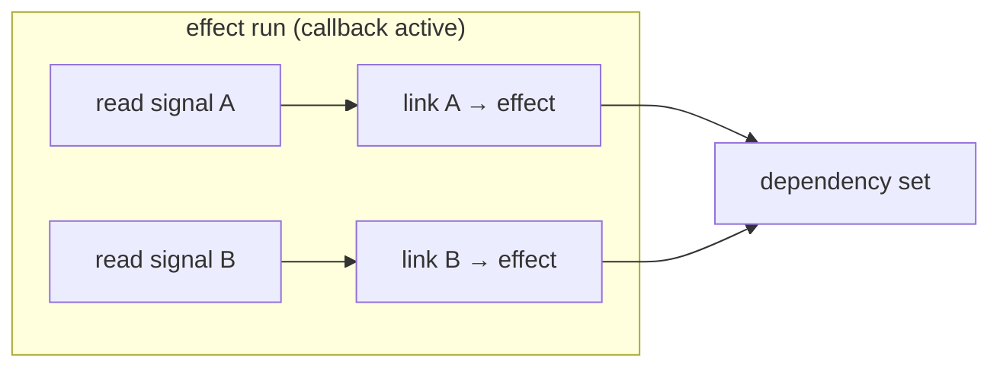
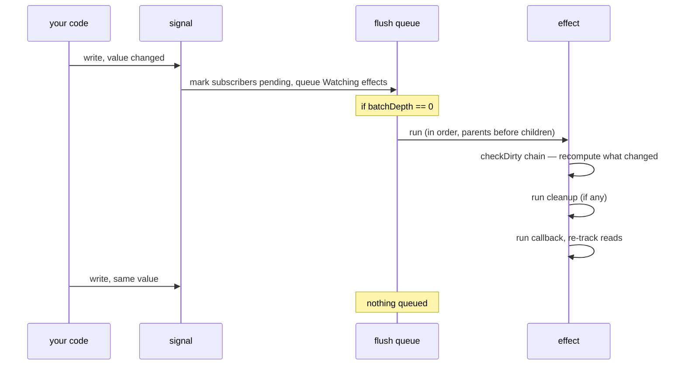

# Signals & Effects

`signal` and `effect` are the two halves of the system: signals are state, effects are observation. This page covers the read/write model, how tracking actually works, and the behaviors you will hit once effects start reading signals dynamically.

## The read/write model

A signal is created with `signal(initialValue)` and is then called to read or write:

```luau
local count = signal(0)

count()   -- read  → 0
count(5)  -- write → sets the value to 5
count()   -- read  → 5
```

The distinction is made by argument count, not by separate methods. One argument (even `nil`) is a write; zero arguments is a read:

```luau
local name = signal("init")
name(nil) -- a *write* of nil, unambiguous in this library
name()    -- read → nil
```

::: tip
`signal(nil)` and `s(nil)` are legal and unambiguous — the node kind is identified by metatable identity, not by probing whether fields exist, which is what makes a `nil`-holding signal behave correctly everywhere.
:::

Writing the same value is a no-op for propagation:

```luau
local count = signal(0)
local runs = 0
effect(function()
    count()
    runs += 1
end)
count(0)   -- same value → no restart
count(1)   -- different → restart, runs == 2
```

## How tracking works

An effect callback's **first run** establishes its dependencies: every signal (or computed) read *while the callback is running* is linked to the effect. Later runs re-establish the set — reads that stop happening unlink themselves.



The linking is positional, not set-based: dependencies live in a linked list in read order, so re-running an effect that reads the same signals in the same order reuses the existing link objects — no reallocation, no per-run hashing. This is one of the reasons the library stays fast on re-runs.

While the callback runs, it is the **active subscriber**: writes performed inside the callback itself are tracked against `runDepth` so the system can detect and handle recursion (see below).

## Dynamic dependencies

Because tracking is re-established on every run, an effect's dependency set can follow a branch:

```luau
local toggle = signal(true)
local a, b = signal("A"), signal("B")

effect(function()
    local source = if toggle() then a else b
    print(source())
end) -- Output: A

a("A2")   -- Output: A2  (a is a dependency this run)
b("B2")   -- no output  (b is not — last read took the other branch)
toggle(false) -- Output: B2 (set changes to b; a is unlinked)
a("A3")   -- no output  (a no longer a dependency)
```

The diamond of "which signal does the effect depend on" is resolved per run, and unused links from the previous run are dropped.

## Effects are also computed values' subscribers

An effect that reads a `computed` does not subscribe to the computed's sources — only to the computed itself. The chain in between reconciles itself lazily when the effect runs. (See [Computed Values](./computed).)

## Writes inside effects

Writing a signal inside an effect callback is allowed. The write propagates, and the effects it reaches (including, potentially, the writer itself) are queued — not run inline. A self-subscribing effect therefore runs **once more** per write cycle, not infinitely:

```luau
local count = signal(0)

effect(function()
    const c = count()
    print(`count is {c}`)
    if c < 3 then
        count(c + 1) -- queue a restart for the next flush
    end
end)
-- Output, in order:
-- count is 0
-- count is 1
-- count is 2
-- count is 3
```

The library distinguishes *outer* writes (from outside any effect) from *inner* writes (performed while an effect runs) and marks propagation accordingly — inner writes set a "recursed" mark so the queue handles self-restarts deterministically rather than looping.

::: warning
Mutual writes between two effects can still ping-pong forever if each always writes in response to the other. The queue processes each restart exactly once per value change, but it cannot detect an oscillating pair — design cycles so they converge (like the counter above) or break them with a guard.
:::

## Cleanup

An effect callback may return a cleanup function. It runs:

- before each restart (so the callback can tear down what it built last run), and
- when the effect is disposed (by calling it, or by its scope being disposed).

```luau
local character = signal(nil :: Player?)

effect(function()
    const char = character()
    if char == nil then return end
    local hum = char:FindFirstChildOfClass("Humanoid")
    -- ... do something with humanoid state
    return function()
        -- teardown for this character, runs before the next run
        -- and on dispose
    end
end)
```

Cleanup runs with the active subscriber **cleared** — a cleanup function cannot accidentally re-subscribe anything by reading signals.

::: danger
Throwing from a cleanup still restores the library's internal state (the subscriber stack is restored before the error propagates), but the error itself propagates to the caller that triggered the flush — wrap your cleanup bodies if that matters to you.
:::

## Reading without subscribing

To read a signal's current value *without* making the enclosing effect depend on it, temporarily install no subscriber — the library exposes the two functions the effect machinery itself uses:

```luau
local signals = require(ReplicatedStorage["luau-signals"])
local setActiveSub = signals.setActiveSub

effect(function()
    const current = (setActiveSub(nil) or nil) -- hmm — see below
end)
```

The practical pattern is:

```luau
effect(function()
    const prev = setActiveSub(nil) :: any
    local value = someSignal()       -- read, tracked by nobody
    setActiveSub(prev)               -- restore tracking
    print(`snapshot: {value}`)
    -- ... signals read after the restore are tracked normally
end)
```

`setActiveSub(nil)` returns the previous subscriber so it can be restored afterwards — during that window, reads link to nothing and the effect will not restart for them. This is the escape hatch for "read for logging/UI only" cases.

::: tip
For most "many writes → one restart" needs you want [batches](./batches) instead; `setActiveSub` is for untracked *reads*, and batches are for coalesced *writes*.
:::

## Nesting

Effects created inside another effect's callback become children: the parent links them as a dependency-like edge, and disposing the parent disposes the children. See [Effect Scopes](./effect-scopes) for the disposal tree — `effectScope` is the same machinery with no callback of its own.

## What runs when — a summary



## Next steps

- [Computed Values](./computed) — the missing third primitive
- [Trigger](./trigger) — re-run observers without writing a value
- [How It Works](./how-it-works) — the graph, flags and queue in depth
