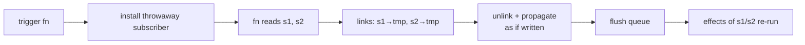

# Trigger

`trigger` re-runs the effects that depend on the signals read inside its function — **without writing any value**. It is the "refresh" primitive: force observers to re-execute with the current, unchanged state.

```luau
local signals = require(ReplicatedStorage["luau-signals"])
local signal, effect, trigger = signals.signal, signals.effect, signals.trigger

local count = signal(1)
local runs = 0

effect(function()
    count()
    runs += 1
end) -- runs == 1

trigger(function()
    count()
end) -- runs == 2 — the effect re-ran, the value is still 1
```

## What it does, step by step

1. A throwaway subscriber node is installed as active.
2. The function runs; every signal read inside links to the throwaway node.
3. The links are unlinked, and each dep is **propagated manually** — subscribers of those signals are marked dirty/queued as if the signals had been written.
4. The queue flushes (inside an implicit batch), running the effects that observe those signals.



The value never changes, so:

- computed cutoff still applies — a computed whose getter returns the same value stops propagation beyond itself, and its effect does **not** re-run,
- but effects that read a *signal* directly always re-run: signals have no cutoff, because nothing recomputed.

```luau
local raw = signal(1)
local parity = computed(function() return raw() % 2 end)
local signalRuns, computedRuns = 0, 0

effect(function() raw(); signalRuns += 1 end)
effect(function() parity(); computedRuns += 1 end)

trigger(function()
    raw()
end)
-- signalRuns == 2   — direct signal read, re-runs
-- computedRuns == 2 — parity's getter re-ran and returned the same value...
```

::: warning
Careful with the second case: `parity`'s getter **does** re-run (it is marked dirty by the propagation), so if the value is unchanged the cutoff stops *the effect* from restarting but the getter still executed. `trigger` is "make them look again", not "make them cheap".
:::

## Only what is read inside

`trigger` affects exactly the signals read during its function — the same dynamic-tracking rules as effects. A signal not read is untouched:

```luau
local a, b = signal(1), signal(1)
local runsA, runsB = 0, 0

effect(function() a(); runsA += 1 end)
effect(function() b(); runsB += 1 end)

trigger(function()
    a()
end)
-- runsA == 2, runsB == 1 — b's effect never ran
```

## Reading without the refresh

Because `trigger`'s function runs with a throwaway subscriber, reads inside it do not subscribe anything *else* — there is no enclosing effect to pollute. But if you call `trigger` inside a running effect (rare), the inner reads are tracked by the throwaway node, not the effect — so an effect can force a refresh of its own dependencies without double-subscribing.

## Typical uses

**Invalidating external state.** A computed that caches a value derived from a non-reactive source (an instance property, a DataStore snapshot, `os.clock`):

```luau
local frame = workspace.Checkpoint
local lastCFrame = frame.CFrame

local positionText = computed(function()
    return `pos: {lastCFrame.Position}` -- reactive part
        .. ` | real: {frame.CFrame.Position}` -- non-reactive part, stale!
end)

-- when the non-reactive world changes:
trigger(function()
    lastCFrame -- read it, so its observers refresh
end)
```

**Manual invalidation hooks.** Wrap a non-reactive event (`.Changed`, a RemoteEvent) into reactivity:

```luau
local scoreRemote = ReplicatedStorage.ScoreRemote
local scoreVersion = signal(0) -- a pure "version" signal

local score = computed(function()
    scoreVersion() -- depends on the version counter
    return readScoreFromSomewhere() -- non-reactive source
end)

scoreRemote.OnClientEvent:Connect(function()
    trigger(function()
        scoreVersion() -- bump observers of `score`
    end)
end)
```

::: tip
A plain write `scoreVersion(scoreVersion() + 1)` does the same job here and is often clearer. Reach for `trigger` when there is no natural value to write, or when writing would cascade somewhere you do not want.
:::

**Re-rendering on demand.** UI that must re-run an effect on a non-value event (viewport size, theme change) where the effect reads signals only for the data part.

## Inside a batch

`trigger` wraps its work in an implicit batch (it increments `batchDepth` around the function and flushes at the end), so multiple signals read inside one `trigger` produce a **single** restart of an effect that observes them all:

```luau
local a, b = signal(1), signal(1)
local runs = 0

effect(function() a(); b(); runs += 1 end)

trigger(function()
    a()
    b()
end) -- runs == 2 — once more, not twice
```

## Error behavior

If the function passed to `trigger` throws, the throwaway subscriber's links are still unlinked and propagated (the cleanup runs before the error is re-thrown) — the reactive state stays consistent, and the error surfaces to the caller.

## Next steps

- [Batches](./batches) — the batching `trigger` leans on
- [How It Works](./how-it-works) — propagation and the flush queue
- [API: trigger](/api/trigger)
